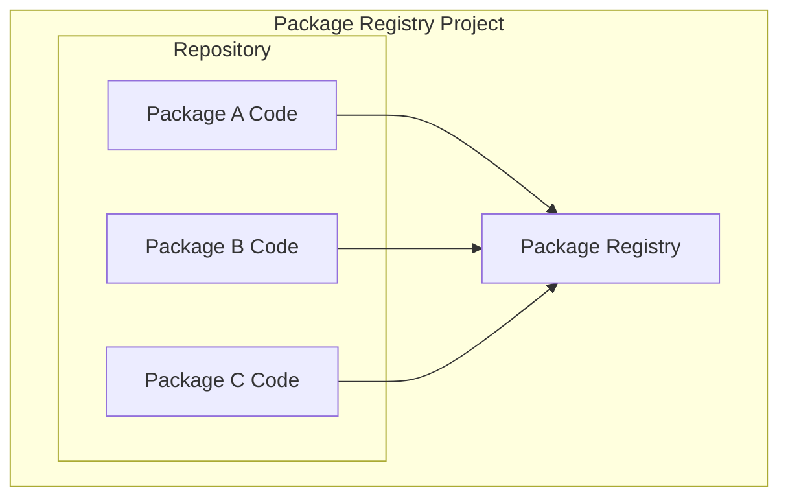
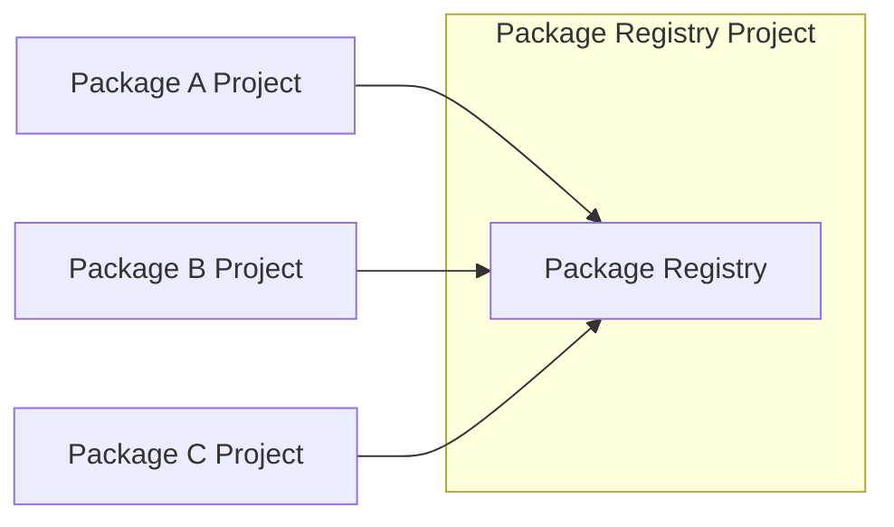
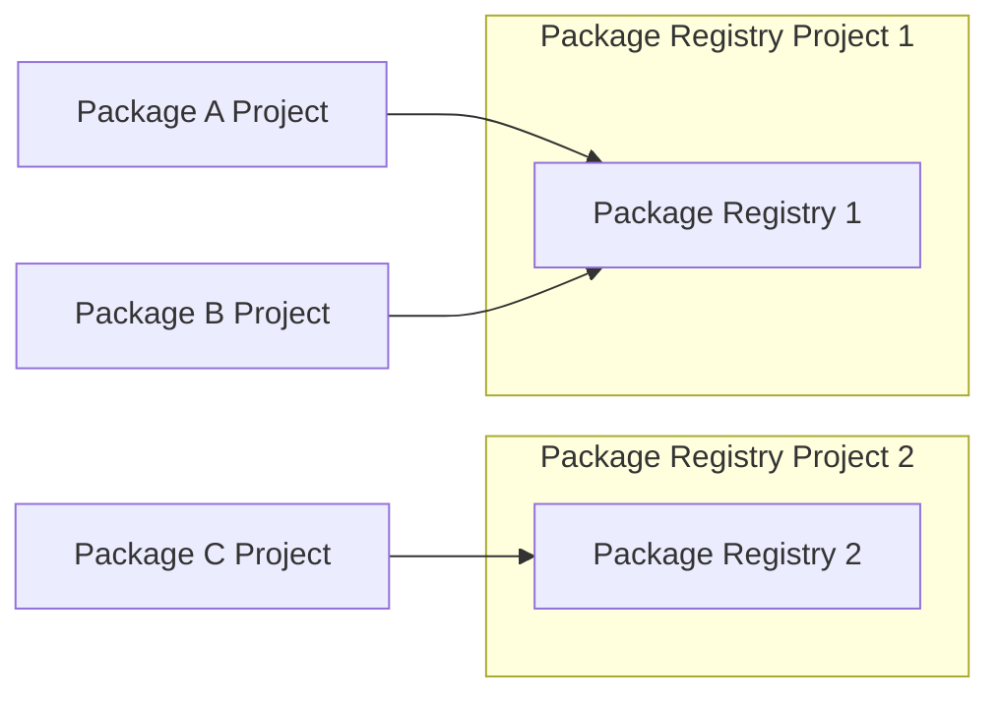
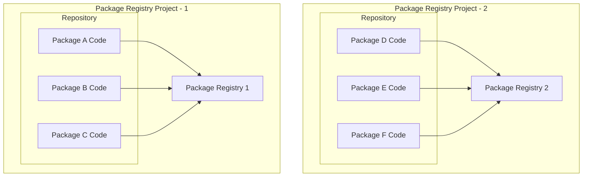
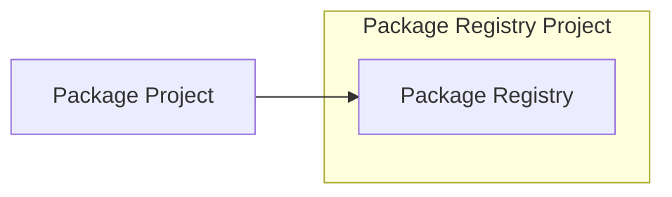
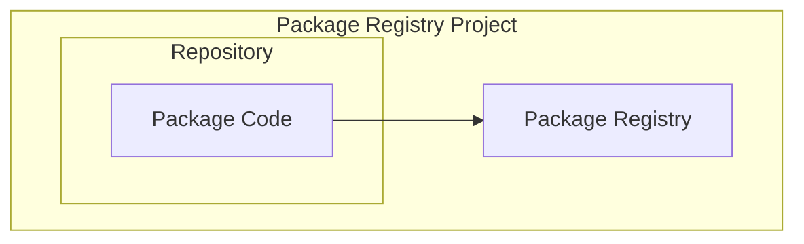

# GitLab Project Registry Organization

## Context

We want to leverage the native gitlab package registry feature, but need to decide on how to organize packages.

Things we want to optimize:

- maximizing granularity and flexibility of access controls
- minimizing the number and reuse of deploy tokens with `write-package-registry` scope
- maximizing the ease of use for consumers
- maximize ownership and accountability of packages

Important context:

- Deploy tokens grant read and write access to package registries at the registry level of granularity; It's not possible to provide access to only a subset of packages within a single registry to a deploy token.
- You are able to create deploy tokens at both a project and group level. A project deploy token provides access to an individual project's package registry. A group deploy token provides access to descendant project package registries.
- There is a limit of 200 projects that can be added to a project's job token allowlist, suggesting that GitLab advises against using `CI_JOB_TOKEN`s for publishing large numbers of packages to a single project.
- By default, a CI/CD pipeline running in a project can use it's `CI_JOB_TOKEN` to publish to it's own package registry.

### Option 1: Project with Registry and All Package Code

This monorepo design has the minimum possible granularity and flexibility of access controls and ownership and accountability of packages.

It's not advisable.

- **Maximizing granularity and flexibility of access controls:** 1/5
- **Minimizing the number and reuse of deploy tokens with `write-package-registry` scope:** 5/5
- **Maximizing the ease of use for consumers:** 5/5
- **Maximize ownership and accountability of packages:** 1/5

### Option 2: Project with Registry and Code Project Per Package

This mono-registry design is good for ease of consumption, but terrible in terms of granularity and flexibility of access controls.

It's not advisable.

- **Maximizing granularity and flexibility of access controls:** 1/5
- **Minimizing the number and reuse of deploy tokens with `write-package-registry` scope:** 1/5
- **Maximizing the ease of use for consumers:** 5/5
- **Maximize ownership and accountability of packages:** 4/5

### Option 3: Project with Registry Per Package Group and Code Project Per Package

This design has is marginally better than option 1 and 2 in terms of access controls, but still requires heavy usage of deploy tokens with `write-package-repository` scope.

Worth considering.

- **Maximizing granularity and flexibility of access controls:** 3/5
- **Minimizing the number and reuse of deploy tokens with `write-package-registry` scope:** 2/5
- **Maximizing the ease of use for consumers:** 3/5
- **Maximize ownership and accountability of packages:** 4/5

### Option 4: Project with Registry and Package Code Per Package Group

This design has is marginally better than option 1 and 2 in terms of access controls, but at the cost of some ownership and accountability.

- **Maximizing granularity and flexibility of access controls:** 3/5
- **Minimizing the number and reuse of deploy tokens with `write-package-registry` scope:** 5/5
- **Maximizing the ease of use for consumers:** 3/5
- **Maximize ownership and accountability of packages:** 3/5

### Option 5: Project with Registry and Code Project Per Package

This design has is great in many areas, but terrible in terms of number of deploy tokens with `write-package-registry` scope, and arguably **too much** flexibility at the cost of complexity.

Not advisable.

- **Maximizing granularity and flexibility of access controls:** 5/5
- **Minimizing the number and reuse of deploy tokens with `write-package-registry` scope:** 1/5
- **Maximizing the ease of use for consumers:** 3/5
- **Maximize ownership and accountability of packages:** 4/5

### Option 5: Project with Registry and Code Per Package

This design has a strong balance of all aspects worth considering.

It's the most advisable.

- **Maximizing granularity and flexibility of access controls:** 5/5
- **Minimizing the number and reuse of deploy tokens with `write-package-registry` scope:** 5/5
- **Maximizing the ease of use for consumers:** 3/5
- **Maximize ownership and accountability of packages:** 5/5

## Decision

We will decide to organize packages with the model of a project with a registry and code per package, and assume the following benefits and costs.

Benefits:

- **Maximized granularity and flexibility of access controls**: this design provides the maximum granulatity of access controls, and an excellent amount of flexibilty. The only other option with more flexibility is option 5, but that option comes at the cost of ownership and accountability of packages.
- **Minimized number and reuse of deploy tokens with `write-package-registry`**: in this design, all packages are published by using the project's own `CI_JOB_TOKEN`, which by default has the ability to publish packages to the project's own package registry.
- **Maximized ownership and accountability of packages**: package projects can be organized within workload groups, where permissions and ownership are managed.

Costs:

- **Ease of use for consumer**: consumers will have to be more conscience of how they authenticate to different registries. For example, are they authenticating using a group deploy token, or a project deploy token?
- We'll have to be diligent and organized about how we hierarchically structure and provide access to package registries. Provisioning of group level deploy tokens with `read-package-registry` should be carefully considered, as any future descendent package registries will become a part of the token's scope.
