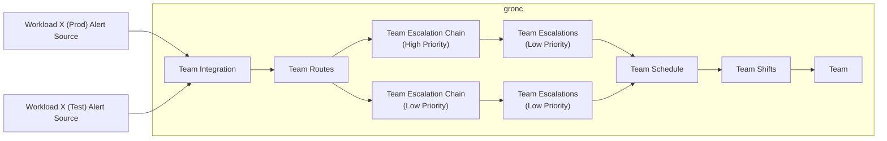
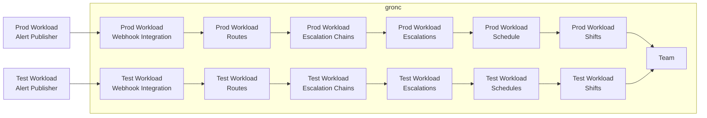

# Manage Workload Alerts Using Grafana On-Call

## Context

- We have things that we monitor
- We have things that monitor those things, producing actionable alerts (e.g. SOAR automations, JupiterOne queries, serverless functions, log analytics)
- We need a thing that manages the lifecycle of those alerts

### The Organization is Moving Towards Grafana On-Call

Currently, the wider organization is working on migrating alert lifecycle management from its previous paging tool to Grafana On-Call (affectionately abbreviated as GrOnC). A good argument is made for adopting Grafana On-Call; we’ll also adopt Grafana On-Call.

This document goes super deep on the current architecture and the future plans for On-Call.

- [On-Call: Current Architecture and Future Plans](https://wiki.example.com/display/ENG/OnCall+-+Current+Architecture+and+Future+Plans)
  - TL;DR: The wider organization evaluated several on-call tools and chose Grafana On-Call.

### Current Grafana On-Call Design (Team-Oriented)

Currently, Grafana On-Call resources are oriented around teams.

To provision and manage a team's On-Call resources, a team will:

1. Make a change to the org-structure repository, indicating that Grafana On-Call is active for the team. The on-call provisioning service runs a periodic task that synchronizes user group membership and permissions from the org-structure repository to Grafana On-Call. See [instructions](https://wiki.example.com/spaces/ENG/pages/100002).
2. Call an on-call provisioning service API endpoint to initialize resources for the team, including those integrations, routes, escalation chains, escalations, schedules, and shifts in the diagram below. See [instructions](https://wiki.example.com/spaces/ENG/pages/100002).
3. Use click ops to manage those resources.

### Proposed Design for Workload Grafana On-Call Resources (Workload-Oriented)

We are proposing orienting our Grafana On-Call resources around workloads instead of teams.

A workload-oriented organization has the following benefits over a team-oriented organization:

- isolation between production and non-production environments
- decoupling of workload alert sources and grafana on-call integration
- ease of workload divestment and ownership

## Decision

We'll create resources in grafana on-call in a resource oriented fashion using standard infrastructure as code principles.

Pros:

- We can provision Grafana On-Call resources as we see fit, in a workload oriented way, using IaC

Cons:

- The credentials needed to manage grafana on-call resources require a wide blast radius ([Grafana On-Call actions don't have applicable scopes](https://grafana.com/docs/grafana-cloud/platform/security-and-account-management/security-and-access/authentication-and-permissions/access-control/custom-role-actions-scopes/)). We've talked with Gronc owners, and they are okay with this level of access.
