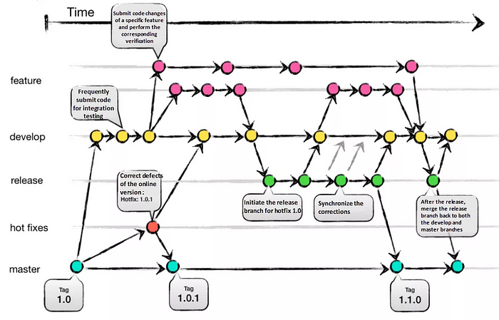
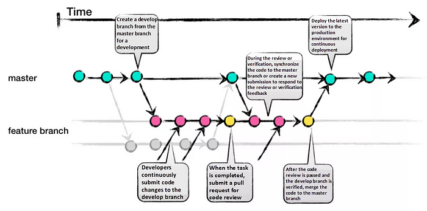
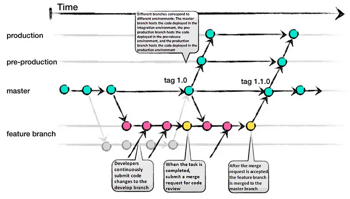
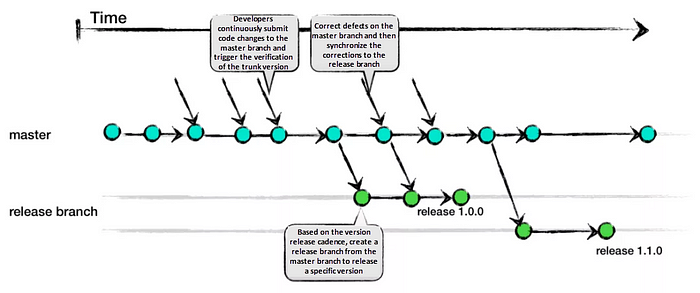

# Use a GitHub Flow Branching Strategy

## Status

| Status   | Date       | Notes                                                                                   |
| -------- | ---------- | --------------------------------------------------------------------------------------- |
| Accepted | 2024-02-16 | Decided on GitLab Flow branching strategy                                               |
| Accepted | 2024-03-08 | GitLab Flow had unintended side-effects. Change to adopt GitHub Flow branching strategy |

## Context

[Choosing the Right Git Branching Strategy - A Comparative Analysis](https://medium.com/@sreekanth.thummala/choosing-the-right-git-branching-strategy-a-comparative-analysis-f5e635443423)

Things that matter to us:

- Tightly control the promotion between stages of development (e.g. `test`, `prod`).

### Options

#### Git-Flow

Git-Flow is a comprehensive branching strategy that aims to cover various scenarios. It defines specific branch responsibilities, such as main/master for production, develop for active development, feature for new features, release as a gatekeeper to production, and hotfix for addressing urgent issues. The life-cycle involves branching off from develop, integrating features, creating release branches for testing, merging into main/master, and tagging versions.

| Benefits                                                             | Costs                                                                        |
| -------------------------------------------------------------------- | ---------------------------------------------------------------------------- |
| Well-suited for large teams and aligning work across multiple teams. | Complexity due to numerous branches, potentially leading to merge conflicts. |
| Effective handling of multiple product versions.                     | Development and release frequency may be slower due to multi-step process.   |
| Clear responsibilities for each branch.                              | Requires team consensus and commitment to adhere to the strategy.            |
| Allows for easy navigation of production versions through tags.      |                                                                              |

#### GitHub Flow

GitHub-Flow simplifies Git-Flow by eliminating release branches. It revolves around one active development branch (often main or master) that is directly deployed to production. Features and bug fixes are implemented using long-living feature branches. Feedback loops and asynchronous collaboration, common in open-source projects, are encouraged.

Since around March 2024, we've adopted GitHub Flow with excellent results. The key principle is that anything merged to the main branch is automatically deployed to production. Guards are put in place in CI/CD pipelines to ensure that non-hotfix branches are required to deploy to testing environments prior to merging to the main branch.

Example Merge Request Pipeline:

_Screenshot removed: a passed merge request pipeline with a `plan` stage (plan jobs for the prod and test environments across `aws:global`, `aws:us-east-1`, and `vault:global`, plus `tflint`), followed by manually triggered `apply-test-global` jobs (`apply:test:aws:global`, `apply:test:vault:global`) and an `apply-test-regional` job (`apply:test:aws:us-east-1`)._

Example Main Branch Pipeline:

_Screenshot removed: a passed main branch pipeline with a `plan` stage (prod plan jobs for `aws:global`, `aws:us-east-1`, and `vault:global`), followed by `apply-prod-global` jobs (`apply:prod:aws:global`, `apply:prod:vault:global`) and an `apply-prod-regional` job (`apply:prod:aws:us-east-1`)._

| Benefits                                              | Costs                                                                                                                                    |
| ----------------------------------------------------- | ---------------------------------------------------------------------------------------------------------------------------------------- |
| Faster feedback cycles and shorter production cycles. | Merging a feature branch implies it is production-ready, potentially introducing bugs without proper testing and a robust CI/CD process. |
| Ideal for asynchronous work in smaller teams.         | Long-living branches can complicate the process.                                                                                         |
| Agile and easier to comprehend compared to Git-Flow.  | Challenging to scale for larger teams due to increased merge conflicts.                                                                  |

#### GitLab Flow

GitLab-Flow strikes a balance between Git-Flow and GitHub-Flow. It adopts GitHub-Flow's simplicity while introducing additional branches representing staging environments before production. The main branch still represents the production environment.

| Benefits                                                    | Costs                                                    |
| ----------------------------------------------------------- | -------------------------------------------------------- |
| Can handle multiple release versions or stages effectively. | Complexity increases when maintaining multiple versions. |
| Simpler than Git-Flow.                                      | More intricate compared to GitHub-Flow.                  |
| Focuses on quality with a lean approach.                    |                                                          |
|                                                             |                                                          |

##### More Friction/Costs

We tried this option initially, but it had some **undesirable side effects**. Primarily:

1. The same code had to be reviewed through a merge request multiple times; once to merge to main, and again for every level of promotion to an environment.
2. Lots of empty merge commits to the environment branches.

An excerpt from the original version of the deployment workflow document demonstrates the friction caused by the second point.

> ### Synchronizing Merge Commits
>
> When merging a feature/bugfix branch into the main branch, using a merge commit helps maintain a clear history of short-lived branches.
>
> When promoting changes through different environments, a fast-forward merge is more appropriate. This avoids unnecessary merge commits.
>
> However, the reality of GitLab is somewhat different. As of January 2024, GitLab mandates a uniform merge method for all merge requests within a project. This means you can't selectively opt for fast-forward merging for some requests and merge commits for others.
>
> As we know from Workflow Best Practices, we want to favor merge commits over fast-forwarding, because it maintains the history of short lived branches, which makes it easier to untangle commits when something inevitably goes horribly wrong.
>
> So, all merge requests should use the merge commit method. See the decision record: [Use Merge Commit Method](./use-the-merge-commit-merge-method.md).
>
> As a result of using exclusively the merge commit method, when changes move from the `main` branch to `test` or `prod` environments via merge requests, they generate merge commits. Consequently, these environment branches may contain commits not found in the `main` branch.
>
> To address this issue, you can occasionally synchronize the merge requests in environment branches with the `main` branch by following these steps:
>
> 1. Merge the `prod` branch into the `test` branch.
> 2. Merge the `test` branch into the `main` branch.

#### Trunk Based Development

Trunk Based Development promotes a single shared branch called "trunk" and eliminates long-living branches. There are two variations based on team size: smaller teams commit directly to the trunk, while larger teams create short-lived feature branches. Frequent integration of smaller feature slices is encouraged to ensure regular merging.

| Benefits                                            | Costs                                                                                       |
| --------------------------------------------------- | ------------------------------------------------------------------------------------------- |
| Encourages DevOps and unit testing best practices.  | Requires an experienced team that can slice features appropriately for regular integration. |
| Enhances collaboration and reduces merge conflicts. | Relies on strong CI/CD practices to maintain stability.                                     |
| Allows for quick releases.                          |                                                                                             |

## Decision

Use the GitHub Flow branching strategy.

## Consequences

| Benefits                                              | Costs                                                                                                                                    |
| ----------------------------------------------------- | ---------------------------------------------------------------------------------------------------------------------------------------- |
| Faster feedback cycles and shorter production cycles. | Merging a feature branch implies it is production-ready, potentially introducing bugs without proper testing and a robust CI/CD process. |
| Ideal for asynchronous work in smaller teams.         | Long-living branches can complicate the process.                                                                                         |
| Agile and easier to comprehend compared to Git-Flow.  | Challenging to scale for larger teams due to increased merge conflicts.                                                                  |
