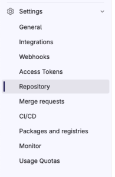
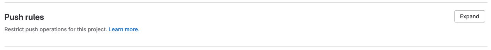
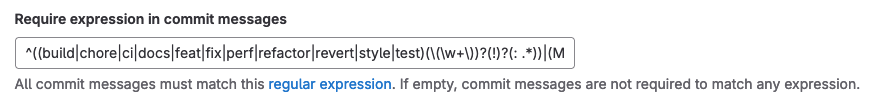

# Enforce Conventional Commit Messages

We can create guardrails to ensure that commit messages follow the [conventional commit format](https://www.conventionalcommits.org/en/v1.0.0/).

For example, we can prevent commit message from being pushed by setting up repository push rules.

1. Navigate to the repository settings

   

2. Expand the push rules section

   

3. Modify the "Require expression in commit messages" field, and click save. **Note:** The regex below is adapted from a stack overflow answer (https://stackoverflow.com/a/62293234) matching basic conventional commits.

   ```txt
   ^((build|chore|ci|docs|feat|fix|perf|refactor|revert|style|test)(\(\w+\))?(!)?(: .*))|(Merge.*)|(Initial commit$)
   ```

   
