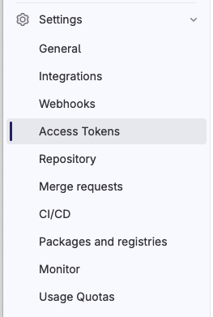
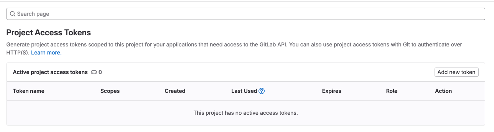
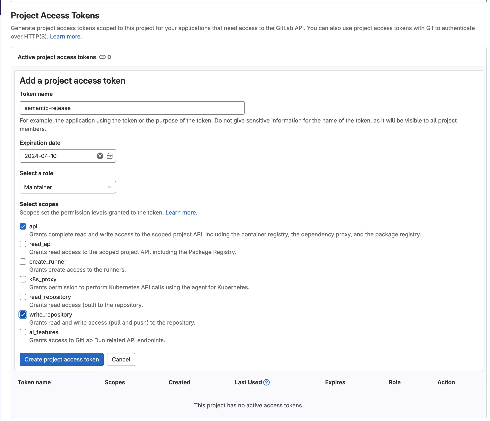
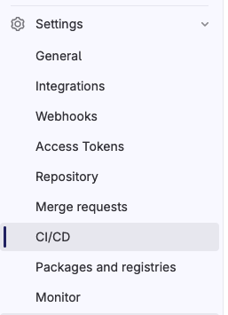
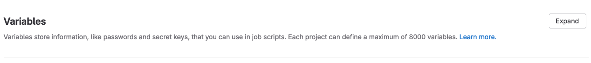
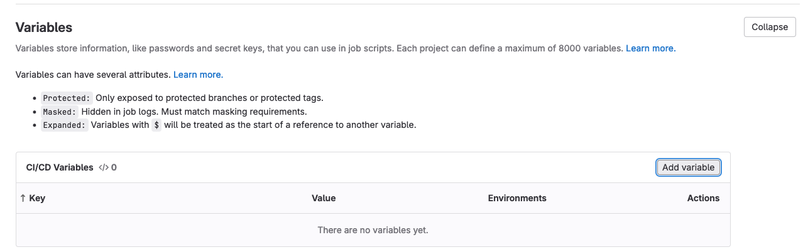
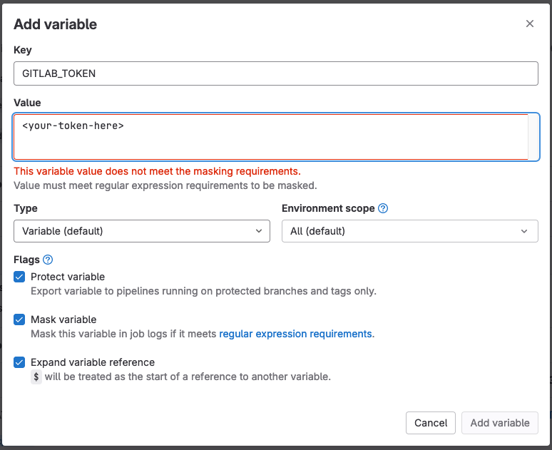

# Automate GitLab Releases

We are able to automate the GitLab release workflow by enforcing [conventional commit](https://www.conventionalcommits.org/en/v1.0.0/) messages with [linting](../../commitlint/guides/lint-conventional-commit-messages.md) and [repository push rules](../../gitlab/guides/enforce-conventional-commit-messages.md), and leveraging [semantic-release](https://semantic-release.gitbook.io/semantic-release/).

## Configure GitLab Project

### Configure Project Settings

1. [Apply baseline repository settings](../../gitlab/guides/configure-baseline-repository-settings.md)
2. [Apply baseline merge request settings](../../gitlab/guides/configure-baseline-merge-request-settings.md)
3. [Enforce conventional commit messages](../../gitlab/guides/enforce-conventional-commit-messages.md)
4. Protect any release, maintenance, or pre-release branches. See [protecting a branch](../../gitlab/guides/protect-a-branch.md).
5. Protect all tags using the wildcard `*`. See [protecting a tag](../../gitlab/guides/protect-a-tag.md).

### Create an Access Token for Semantic Release

1. Navigate to the access token settings

   

2. Click "Add new token"

   

3. Create a token named "semantic-release" with the Maintainer role and api and write_repository permissions. Copy the token value to your clipboard. You'll be creating a CI/CD variable with it.

   

4. Navigate to the CI/CD settings

   

5. Expand the variables section

   

6. Click "Add variable"

   

7. Create a variable named `GITLAB_TOKEN`, paste your token, and configure the variable to be protected and masked.

   

## Configure Code

### Lint Conventional Commit Messages

[Lint conventional commit messages](../../commitlint/guides/lint-conventional-commit-messages.md).

### Add Semantic Release to your CI/CD

1. Install `semantic-release` packages for publishing gitlab releases as development dependencies.

   ```sh
   npm install --save-dev semantic-release @semantic-release/gitlab conventional-changelog-conventionalcommits
   ```

2. Add the following settings to your `package.json`, or [leverage shared configuration from @engineering/npm-dev-tools](../../gitlab/guides/leverage-shared-npm-configuration.md) in a `.releaserc.js`:

   `.releaserc.js`

   ```js
   module.exports = {
     extends: [
       "@engineering/npm-dev-tools/config/semantic-release/tag-format",
       "@engineering/npm-dev-tools/config/semantic-release/branches",
       "@engineering/npm-dev-tools/config/semantic-release/gitlab-plugins",
     ],
   };
   ```

   `package.json`

   ```json
   {
     "release": {
       "tagFormat": "${version}",
       "branches": [
         "+([0-9])?(.{+([0-9]),x}).x",
         "{main,master}",
         { "name": "rc", "prerelease": true },
         { "name": "beta", "prerelease": true },
         { "name": "alpha", "prerelease": true }
       ],
       "plugins": [
         [
           "@semantic-release/commit-analyzer",
           {
             "preset": "conventionalcommits"
           }
         ],
         "@semantic-release/release-notes-generator",
         [
           "@semantic-release/gitlab",
           {
             "assets": {
               "path": "README.md"
             }
           }
         ]
       ]
     }
   }
   ```

   - `"+([0-9])?(.{+([0-9]),x}).x"` matches `<major>.<minor>.x` and `<major>.x.x` branches. These are the **maintenance** branches. The glob is pulled from [semantic releases defaults for the branch configuration](https://semantic-release.gitbook.io/semantic-release/usage/configuration#branches).
   - `{main,master}` matches `main` or `master` branches. These are the **release** branches.
   - `rc`, `beta`, and `alpha` matches branches of the same name. These are the **pre-release** branches.
   - Note: the order of the plugins matter.

3. Add a release job to your `.gitlab-ci.yml` file. Remember though, [it is preferable to build your release pipeline using published GitLab CICD components](../../../workflows/release-workflow/release-workflow.md#cicd).

   ```yml
   release:
     image: node
     stage: release
     script:
       - npm install
       - npx semantic-release
     rules:
       - if: $CI_COMMIT_BRANCH && $CI_COMMIT_REF_PROTECTED == "true"
   ```
