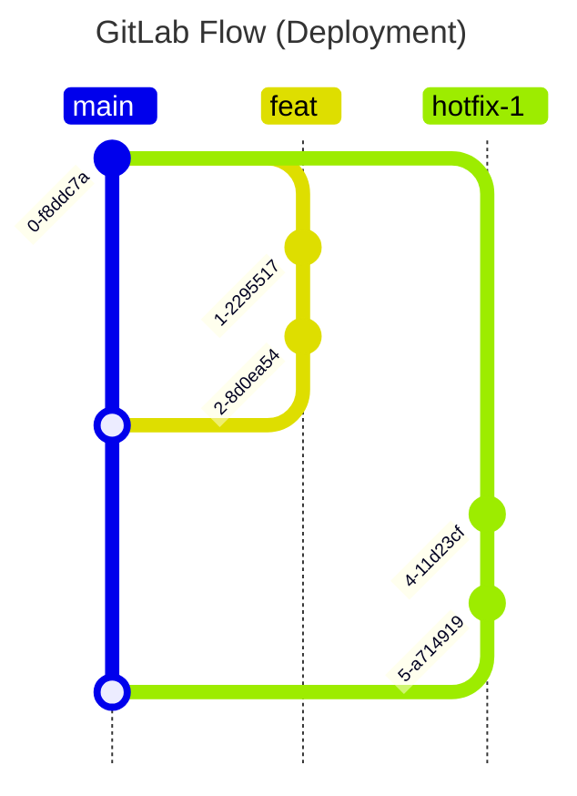

# Deployment Workflow

A deployment workflow consumes releases of software to achieve a goal within an environment.

It's important to distinguish between release and deployment workflows. [Release workflows](../release-workflow/release-workflow.md) produce software versions that are semantically versioned because other components depend on the interface changing predictably. Deployment projects, on the other hand, produce deployments that are inherently \*_not versioned_- because nothing depends on them changing predictably.

Below is a git graph diagram that encompasses \*most- workflow use cases.

## Branch Types

### Main Branch

- Contains the most up-to-date commits
- Promotes deployments through protected environments
- Is long-lived
- All branches branch off from it and merge back into it

### Feature/Bugfix Branches

- Always branch off of `main`
- Always merge into `main`
- Contains commits that implement a feature/bugfix
- Are short-lived
- Must be deployed to unprotected environments and tested in those environments before they can be merged into `main` (e.g., a deployment to the `development` environment, then automated testing in the `development` environment)

### Hotfix Branches

- Are created to intentionally circumvent testing in unprotected environments. Should only be used when the benefit of getting a change out quick to production outweighs the cost of potentially introducing more bugs to production.
- Always branch off of `main`
- Always merge into `main`
- Should follow a naming convention `hotfix-*`
- Contains commits that implement a hotfix
- Are short-lived
- Aren't deployed to unprotected environments before being merged into `main`

## Actions

### Developing a Feature/Bugfix

To develop a new feature:

1. Create a `feature/bugfix` branch from the `main` branch
2. Commit changes to the `feature/bugfix` branch to complete the feature/bugfix
3. Deploy to an unprotected environment from a CI/CD pipeline
4. Test the deployed changes in the unprotected environment
5. Create a merge request from the `feature/bugfix` branch to the `main` branch
6. Merge the `feature/bugfix` branch into the `main` branch.
7. Promote deployments through protected environments. For example, first, a deployment to the `staging/testing` environment, then automated testing in the `staging/testing` environment, then finally a deployment to `production`.

### Developing a Hotfix

To apply a hotfix:

1. Create a `hotfix-*` branch from the `main` branch
2. Commit changes to the `hotfix-*` branch to complete the hotfix
3. Create a merge request from the `hotfix-*` branch to the `main` branch
4. Merge the `hotfix-*` branch into the `main` branch.
5. Promote deployments through protected environments. For example, first, a deployment to the `staging/testing` environment, then automated testing in the `staging/testing` environment, then finally a deployment to `production`.

## Patterns

There are three deployment patterns to choose from:

1. [Basic Deployment](./patterns/basic-deployment.md): A pattern where a workload manages its own infrastructure deployment through a single, self-contained project. The workload bootstraps its own state management and provisions resources directly across environments.

2. [Partitioned Deployment](./patterns/partitioned-deployment.md): A pattern where a workload is structured around a dedicated management project that provisions shared infrastructure, and separate concern-specific projects that handle different aspects of the workload.

3. [Terraform Backend-as-a-Service](./patterns/terraform-backend-as-a-service.md): A pattern where a centralized platform team provisions and manages Terraform backend components, enabling other workloads to manage infrastructure without maintaining their own backend infrastructure.

Each of these patterns is typically implemented [by creating a collection of terraform deployment projects](./guides/create-a-terraform-deployment-project.md). Workloads may implement a combination of these patterns to meet their specific requirements.

## Project Settings

### Implement Workflow Project Settings

See [workflow project settings](../workflows.md#project-settings)

### Protect The Default Branch

[Protect the default branch](../../tools/gitlab/guides/protect-a-branch.md), whether it be `main` or `master` or something else.

## Best Practices

### Follow All Workflow Best Practices

See [workflow best practices](../workflows.md#best-practices).

## CI/CD

Use the following CI/CD components to compose your deployment workflow CI/CD pipeline:

- [gitlab-cicd-workflow](https://gitlab.example.com/engineering/dev-tools/internal/gitlab-cicd-workflow) - provides `workflow`, `deploy-if-protected`, `run-if-unprotected`, and `stack-trigger-rules` components
- [gitlab-cicd-vault](https://gitlab.example.com/engineering/vault/internal/gitlab-cicd-vault)
- [gitlab-cicd-terraform](https://gitlab.example.com/explore/catalog/engineering/dev-tools/gitlab-cicd-components/gitlab-cicd-terraform) (if using terraform)
