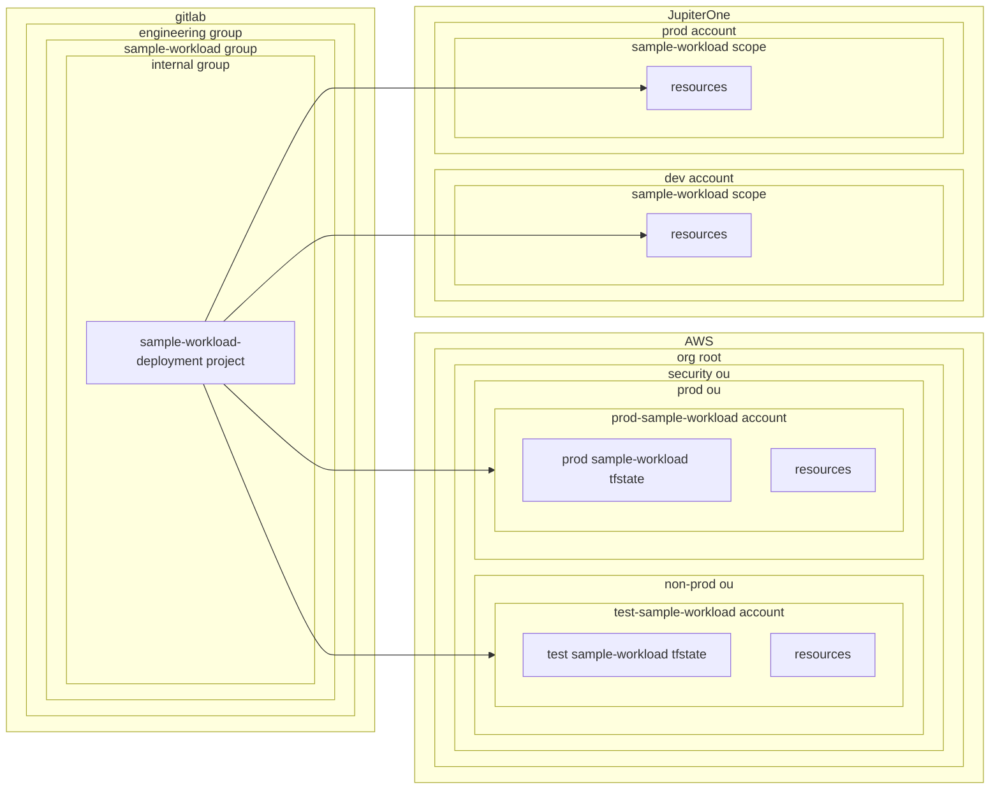

# Architectural Pattern: Basic Deployment

A Terraform-based pattern where a workload manages its own infrastructure deployment through a single, self-contained project. The workload bootstraps its own Terraform state management and provisions resources directly across multiple platforms and environments without requiring a separate management layer.

This pattern provides simplicity and direct control, making it suitable for workloads with straightforward deployment requirements that don't need complex separation of concerns or shared infrastructure management.

## Access Patterns

This architectural pattern typically leverages the following access patterns:

- [GitLab to AWS](../../../workloads/patterns/access/gitlab-to-aws.md) - For authenticating GitLab CI/CD pipelines to AWS using SPIFFE JWTs
- [GitLab to Platform](../../../workloads/patterns/access/gitlab-to-platform.md) - For authenticating to other platforms like JupiterOne using static credentials
- [Terraform Deployment CI/CD Access](../../../workloads/patterns/access/terraform-deployment-cicd-access.md) - For controlling access to Terraform state and infrastructure based on branch protection status

## Example: `sample-workload`

`sample-workload` is a workload that follows the basic deployment pattern. It has its own AWS accounts where it bootstraps state, and then provisions resources using Terraform in both AWS and JupiterOne. The single deployment project manages all aspects of the workload's infrastructure, from state management to resource provisioning across both platforms.

The deployment project uses the [GitLab to AWS](../../../workloads/patterns/access/gitlab-to-aws.md) access pattern to authenticate to AWS accounts and the [GitLab to Platform](../../../workloads/patterns/access/gitlab-to-platform.md) access pattern to authenticate to JupiterOne using static credentials.

