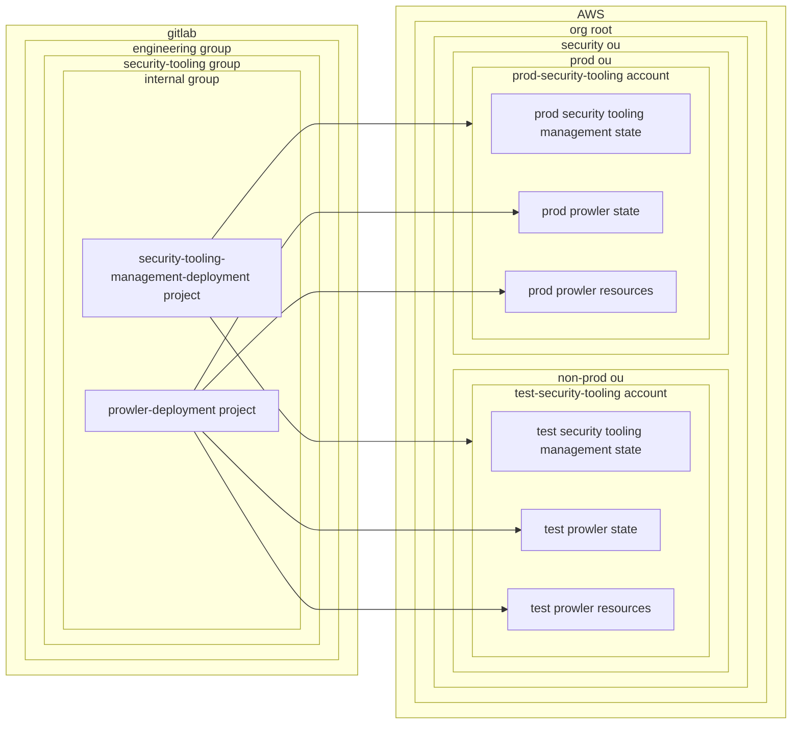

# Architectural Pattern: Partitioned Deployment

A Terraform-based pattern in which a workload is structured around a dedicated management project that provisions shared infrastructure, backend configuration, and access controls. This management project establishes the infrastructure boundary and serves as the bootprap layer that enables concern-specific Terraform projects within the workload to operate.

Each deployment concern is implemented in its own scoped Terraform project. These concern projects are mutually exclusive and collectively exhaustive, and they depend on the resources and access provisioned by the management project to deploy infrastructure safely and consistently.

This pattern enables separation of concerns, workload-level autonomy, and consistent integration with shared platform services.

## Access Patterns

This architectural pattern typically leverages the following access patterns:

- [GitLab to AWS](../../../workloads/patterns/access/gitlab-to-aws.md) - For authenticating GitLab CI/CD pipelines to AWS using SPIFFE JWTs
- [GitLab to Platform](../../../workloads/patterns/access/gitlab-to-platform.md) - For authenticating to other platforms using static credentials
- [Terraform Deployment CI/CD Access](../../../workloads/patterns/access/terraform-deployment-cicd-access.md) - For controlling access to Terraform state and infrastructure based on branch protection status

## Example: `security-tooling`

`security-tooling` is a workload that provides centralized security monitoring and compliance tools across AWS accounts. It follows the partitioned deployment pattern with a dedicated management project [security-tooling-management](https://gitlab.example.com/engineering/security-tooling/internal/security-tooling-deployment) that provisions S3 buckets for Terraform state, DynamoDB tables for state locking, and IAM roles with least-privilege permissions for each deployment concern.

Each security tool operates as an independent concern - `prowler` for compliance scanning, along with other tools like GuardDuty configurations and Config rules. The management project must be deployed first to establish the foundation, after which concern-specific projects can deploy independently.

The `prowler-deployment` project is granted access to its vended Terraform backend and the specific IAM permissions needed to create prowler resources. This separation allows the prowler team to deploy updates independently while maintaining consistent access controls and state management across all security tools.

