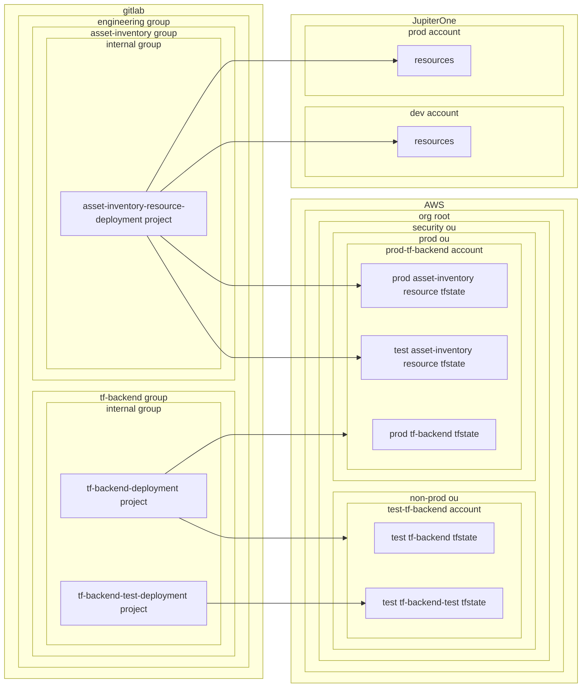

# Architectural Pattern: Terraform Backend-as-a-Service

A pattern designed to support workloads that do not have the ability to provision or manage their own remote state infrastructure.

In this pattern, a centralized platform team provisions and manages the Terraform backend components, including remote state storage, state locking, and authentication. Consumers access these backends through a standardized interface, enabling them to securely manage Terraform state without owning or maintaining the underlying infrastructure.

This approach ensures consistent, secure, and governed state management across teams, and supports the adoption of Terraform in constrained or centralized environments.

## Access Patterns

This architectural pattern typically leverages the following access patterns:

- [GitLab to AWS](../../../workloads/patterns/access/gitlab-to-aws.md) - For authenticating GitLab CI/CD pipelines to AWS using SPIFFE JWTs
- [GitLab to Platform](../../../workloads/patterns/access/gitlab-to-platform.md) - For authenticating to other platforms using static credentials
- [Terraform Deployment CI/CD Access](../../../workloads/patterns/access/terraform-deployment-cicd-access.md) - For controlling access to Terraform state and infrastructure based on branch protection status

## Example: `tf-backend`

`tf-backend` provides a centralized Terraform backend service that enables engineering teams to manage infrastructure as code without maintaining separate backend infrastructure. The service is implemented through the [tf-backend-deployment](https://gitlab.example.com/engineering/tf-backend/internal/tf-backend-deployment) project and handles Terraform state storage, locking, and IAM permissions in AWS. As an example, the `asset-inventory` engineering workload uses this service via the [asset-inventory-resource-deployment](https://gitlab.example.com/engineering/asset-inventory/internal/asset-inventory-resource-deployment) project to manage resources such as queries, dashboards, and alert rules.

