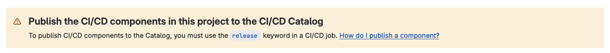

# Create a GitLab CI/CD Component Release Project

See [GitLab CI/CD Components Catalog](https://docs.gitlab.com/ci/components/).

## A note on the requirement of the keyword `release` in `.gitlab-ci.yml` files

There is currently conflicting GitLab documentation on how to publish a component to the catalog.

Some documentation and UI dialogs suggest that a .gitlab-ci.yml file must include the release keyword.

However, [other documentation indicates](https://docs.gitlab.com/ci/components/) that any release created will be picked up by the catalog, without the explicit need for the release keyword in the .gitlab-ci.yml file.

After some experimentation, we've concluded that the latter is correct: any release created is picked up by the CI/CD Catalog, provided it meets the [common prerequisites for publishing a new release of a CI/CD project](https://docs.gitlab.com/ci/components/).

## Setup

1. Apply release workflow [project settings](../release-workflow.md#project-settings) and [best practices](../release-workflow.md#best-practices). This will include automating releases with semantic release.
