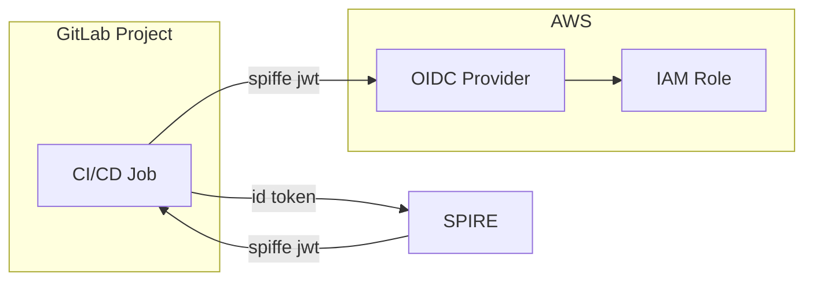

# Access Pattern: GitLab to AWS

GitLab CI/CD jobs authenticate directly to AWS using temporary SPIFFE JWTs, issued by a SPIRE instance.

## How It Works

GitLab pipeline jobs request temporary SPIFFE JWTs from SPIRE instances using their pipeline token claims. SPIRE validates these tokens and vends JWTs containing the project path and reference protection status. AWS OIDC providers validate these JWTs and allow assumption of IAM roles based on trust policy conditions.



## SPIFFE JWT Claims

SPIFFE JWTs contain:

- `sub`: SPIFFE ID with project path and protection status (e.g., `spiffe://prod.example.com/v1/gitlab/path/engineering/workload-name/deployment/protected`)
- `aud`: AWS account ID

## Terraform Configuration

Use Terraform to configure IAM role trust policies that trust GitLab CI/CD pipelines based on their protection status.

```hcl
# IAM Role Trust Policy for Unprotected Branches
data "aws_iam_policy_document" "unprotected_role_trust_policy" {
  statement {
    effect = "Allow"
    principals {
      type        = "Federated"
      identifiers = [aws_iam_openid_connect_provider.spire_oidc_provider.arn]
    }
    actions = ["sts:AssumeRoleWithWebIdentity"]
    condition {
      test     = "StringEquals"
      variable = "oidc-spire.example.com:sub"
      values   = ["spiffe://prod.example.com/v1/gitlab/path/${data.gitlab_project.deployment_project.path_with_namespace}/unprotected"]
    }
    condition {
      test     = "StringEquals"
      variable = "oidc-spire.example.com:aud"
      values   = [data.aws_caller_identity.main.account_id]
    }
  }
}

# IAM Role Trust Policy for Protected Branches
data "aws_iam_policy_document" "protected_role_trust_policy" {
  statement {
    effect = "Allow"
    principals {
      type        = "Federated"
      identifiers = [aws_iam_openid_connect_provider.spire_oidc_provider.arn]
    }
    actions = ["sts:AssumeRoleWithWebIdentity"]
    condition {
      test     = "StringEquals"
      variable = "oidc-spire.example.com:sub"
      values   = ["spiffe://prod.example.com/v1/gitlab/path/${data.gitlab_project.deployment_project.path_with_namespace}/protected"]
    }
    condition {
      test     = "StringEquals"
      variable = "oidc-spire.example.com:aud"
      values   = [data.aws_caller_identity.main.account_id]
    }
  }
}
```

## Access Patterns

- **Unprotected branches** can assume roles with limited permissions
- **Protected branches** can assume roles with elevated permissions
- Trust is established through SPIFFE ID validation containing project path and protection status

## Implementation

1. Configure AWS OIDC provider for SPIRE instance
2. Create IAM roles with appropriate trust policies
3. Configure GitLab jobs to request SPIFFE JWTs from SPIRE using pipeline tokens
4. Use AWS STS to assume roles with SPIFFE JWT tokens
