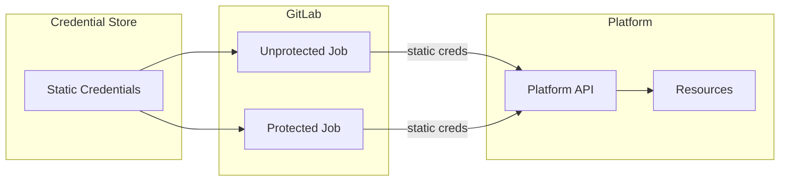

# Access Pattern: GitLab to Platform

For platforms that don't support dynamic authentication methods like OIDC or JWT, GitLab CI/CD jobs authenticate using static credentials.

Static credentials are long-lived authentication tokens, API keys, or service account credentials that are pre-provisioned and made available to CI/CD jobs through various mechanisms.

## Access Control

- Access control depends on the credential storage mechanism (GitLab variables, external secrets management, etc.)
- Branch-based access control may be implemented through protected credentials
- Environment-specific credentials can be scoped to deployment contexts

## Security Considerations

- Static credentials have longer exposure windows than dynamic tokens
- Credential rotation requires manual updates across storage systems
- Access control relies on the underlying credential storage and delivery mechanism
- Audit trails depend on both GitLab job logs and credential system logs

## Use Cases

- Legacy platforms without modern authentication support
- Third-party services with API key-based authentication
- Platforms where dynamic credential provisioning is not feasible
- Emergency access scenarios where dynamic methods are unavailable
