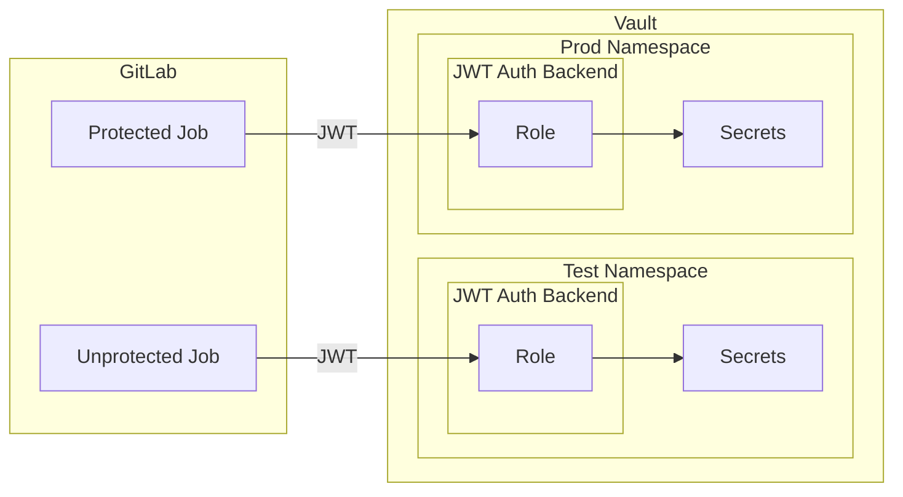

# Access Pattern: GitLab to Vault

For secrets management and other Vault-based services, GitLab CI/CD jobs authenticate to Vault namespaces using [ID token authentication](https://docs.gitlab.com/ci/secrets/id_token_authentication/).

Each GitLab CI/CD job can request ID tokens containing standard claims like `sub` and `aud`, along with custom claims such as `project_id`, `ref_type`, `ref_protected`, `deployment_tier`, and `environment`.

Vault JWT auth backend roles can be bound to certain claims, only allowing a GitLab CI/CD job to login if the claims are appropriate.

For example, an unprotected branch job can authenticate to a test namespace role to access test secrets, while a protected branch job can authenticate to a production namespace role to access production secrets.

JWT auth backend roles use bound claims to control access:

- Test role: `project_id: "123"`, `ref_protected: "false"`
- Production role: `project_id: "123"`, `ref_protected: "true"`

