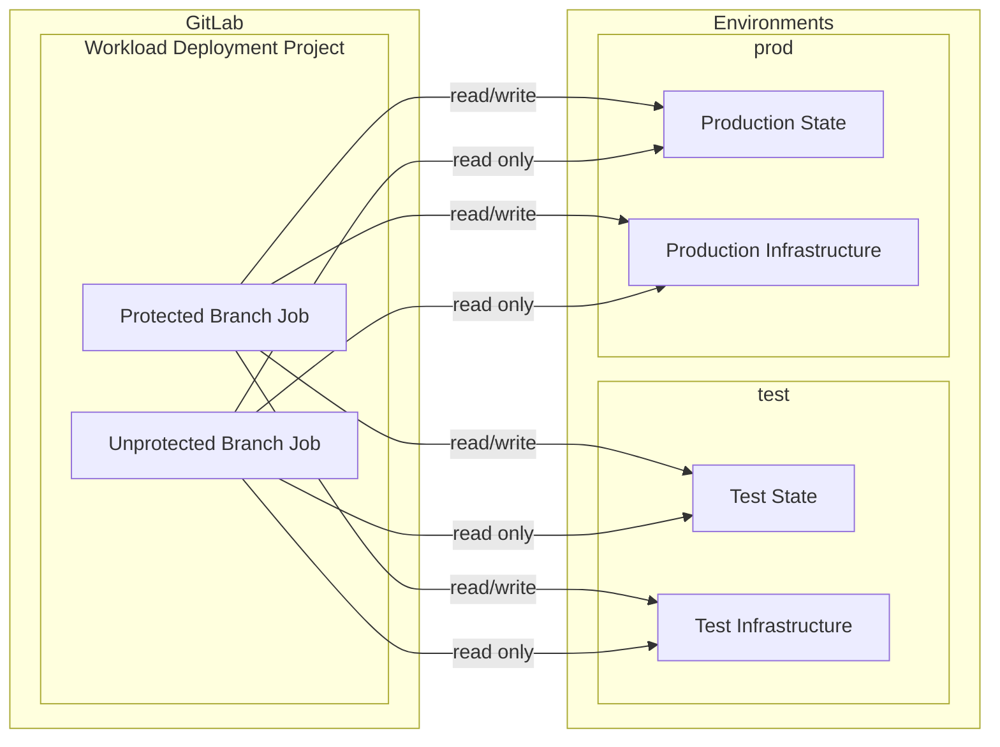

# Access Pattern: Terraform Deployment CI/CD Access

A pattern that defines how CI/CD jobs in Terraform deployment projects access state and infrastructure based on branch protection status.

## How It Works

CI/CD jobs running in different contexts (protected vs. unprotected branches) are granted different levels of access to Terraform state and infrastructure resources:

- **Unprotected branches**: Jobs can read state and view managed infrastructure in all environments (including production), but cannot modify them
- **Protected branches**: Jobs can both read and modify state and infrastructure in all environments

## Access Levels

| Branch Type | Operation              | Test Environment | Production Environment |
| ----------- | ---------------------- | ---------------- | ---------------------- |
| Unprotected | Read (plan, show)      | ✅               | ✅                     |
| Unprotected | Write (apply, destroy) | ❌               | ❌                     |
| Protected   | Read (plan, show)      | ✅               | ✅                     |
| Protected   | Write (apply, destroy) | ✅               | ✅                     |

## Implementation

This pattern is typically implemented using the [GitLab to AWS](./gitlab-to-aws.md) access pattern, but can be adapted for other cloud providers like Azure or GCP. The key implementation details include:

- Different IAM roles for protected and unprotected branch contexts
- Read-only permissions for unprotected branch roles
- Full permissions for protected branch roles
- Authentication based on branch protection status

## Security Considerations

- Unprotected branches are granted read access to production state to enable developers to validate changes against the actual production environment before merging
- This allows for early detection of potential issues while maintaining the protection that only protected branches can apply changes
- The separation ensures that changes to production infrastructure must go through code review and approval processes
- Access to sensitive information in state files should be considered when implementing this pattern

## Use Cases

- Terraform deployment projects that manage infrastructure across multiple environments
- CI/CD pipelines that need to validate changes against production state before merging
- Organizations that want to maintain strict controls on production infrastructure changes while enabling developer visibility
