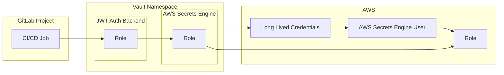

# Access Pattern: Vault to AWS

**⚠️ DEPRECATED**: This pattern has been superseded by [GitLab to AWS Via SPIFFE JWT](../access/gitlab-to-aws.md). GitLab now uses SPIFFE JWTs for direct AWS authentication, eliminating the need for Vault intermediation.

---

_The following documentation is preserved for historical reference._

In scenarios where an AWS account couldn't directly federate access to a public accessible GitLab instance [using an OIDC provider](https://docs.gitlab.com/ci/cloud_services/aws/), it was helpful to have an AWS secrets engine in a Vault namespace mediate temporary access of authorized GitLab CI/CD jobs to roles in those AWS accounts.

See related decision record [workload cicd access to csp roles is mediated by vault](../../../decision-records/deprecated/workload-cicd-access-to-csp-roles-is-mediated-by-vault.md) (now superseded).

See Vault's documentation on the [AWS Secrets Engine](https://developer.hashicorp.com/vault/docs/secrets/aws), it's [setup](https://developer.hashicorp.com/vault/docs/secrets/aws), and the [STS assumed_role](https://developer.hashicorp.com/vault/docs/secrets/aws) credential type.

An excerpt:

> The AWS secrets engine generates AWS access credentials dynamically based on IAM policies. This generally makes working with AWS IAM easier, since it does not involve clicking in the web UI. Additionally, the process is codified and mapped to internal auth methods (such as LDAP). The AWS IAM credentials are time-based and are automatically revoked when the Vault lease expires.
>
> ... 2. assumed_role: Vault will call sts:AssumeRole and return the access key, secret key, and session token to the caller.
> ...

A diagram of this potential setup:

