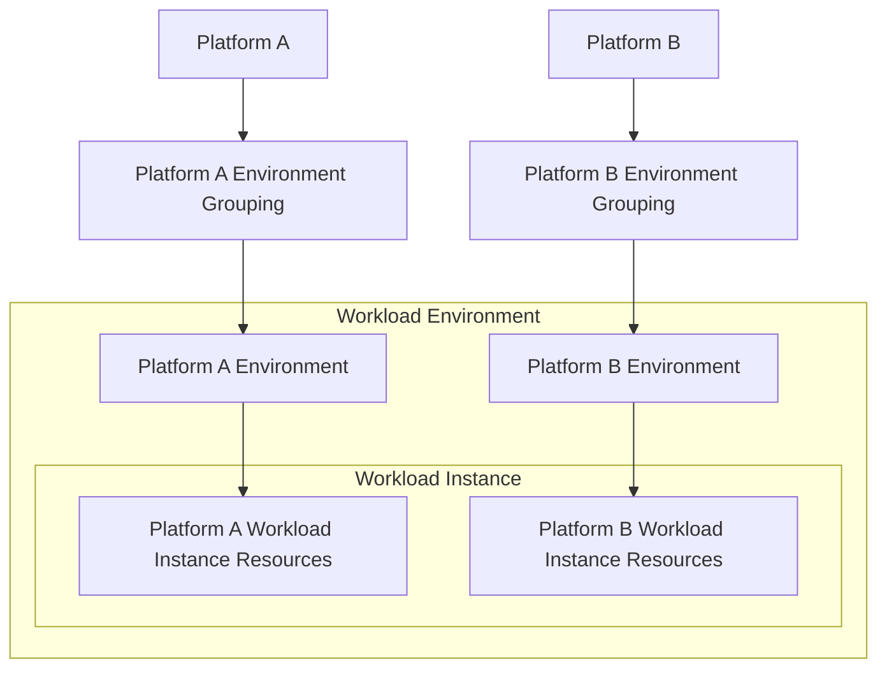

# Workload Concepts

## Diagram

## Workload

A "workload" is a discrete collection of components and data that reside in environments.

## Workload Projects

Workload projects that follow the [release workflow](../workflows/release-workflow/release-workflow.md) publish and can consume [semantically versioned](https://semver.org/) artifacts.

Workload projects that follow the [deployment workflow](../workflows/deployment-workflow/deployment-workflow.md) (most commonly [terraform deployment projects](../workflows/deployment-workflow/guides/create-a-terraform-deployment-project.md)) deploy resources to environments. Those resources may consume those published semantically versioned artifacts.

See decision record: [Separate workload code into deployment and release projects](../decision-records/separate-workload-code-into-deployment-and-release-projects.md).

## Platform

A "platform" is a comprehensive software solution that provides essential services and tools for building, managing, and deploying applications and services within an environment.

Examples of platforms:

- AWS
- Azure
- GCP
- Vault
- JupiterOne

## Workload Instance

You typically have multiple instances of a given workload. This allows you to experiment, develop, and test changes to the workload before you promote and deploy those changes to the production workload environment.

## Workload Environment

We can refer to the set of related security boundaries in which your workload instances reside as a "workload environment".

For example, you might have a dedicated production environment in which your production workload instances reside.

It's important to note that since a workload instance's resources and data might be distributed across multiple platforms, a workload environment might in fact be a composition of security boundaries on each of those platforms.

You might notice that each platform implements security boundaries in their own way.

See the table below:

| Platform | Environment Security Boundary Implementation |
| -------- | -------------------------------------------- |
| AWS      | Account                                      |
| Azure    | Subscription                                 |
| GCP      | Project                                      |
| Vault    | Namespace                                    |

## Production and Non-Production Environments

It can be beneficial to group environments together based on a common set of applied guardrails and policies. In general, it's recommended to create groupings and guardrails that isolate production environments from non-production environments.

In AWS, this grouping of environment containers is implemented as organization units (OUs). We recommend that you isolate production workload instances and data in production accounts housed within production OUs, under your top-level workload-oriented OUs. Apart from production OUs, we recommend that you define one or more non-production OUs that contain accounts and workload instances that are used to develop and test workloads.

In Vault, this grouping of workload environment containers can be implemented as a set of the same policies being applied to a set of like minded namespaces. We recommend applying a set of production policies to a workload's production namespaces, and a set of relevant non-production policies to each set of a workload's non-production namespaces.

| Platform | Environment Grouping Implementation |
| -------- | ----------------------------------- |
| AWS      | Organizational Unit                 |
| Vault    | Policies                            |

## Dependencies Across Environments

When you consider the structure of your workload environment groupings, you should decide on the extent to which you expect access between production and non-production environments.

### Production Environments Accessing Non-Production

Generally, workloads deployed to your production environments should not depend on workloads contained in your non-production environments.

### Non-Production Environments Accessing Dependencies

In non-production environments, it is common for workloads to depend on stable shared application, data, and infrastructure services. Where feasible, we recommend that these shared services be non-production test instances. These non-production test instances should use test data so that your non-production workloads do not depend on access to your production environments and data.

For example, you can configure workloads in a non-production test environment that depend on integrating with a data service to use a stable, shared test instance of the service that is populated with test data.

However, in some cases non-production environments might need access to production shared services. For example, it’s typical for non-production development and test environments to require read-only access to shared source code and artifact management services. Providing access to these shared services enables you to deploy candidate and promoted changes and artifacts to your non-production environments in support of development and testing activities.
