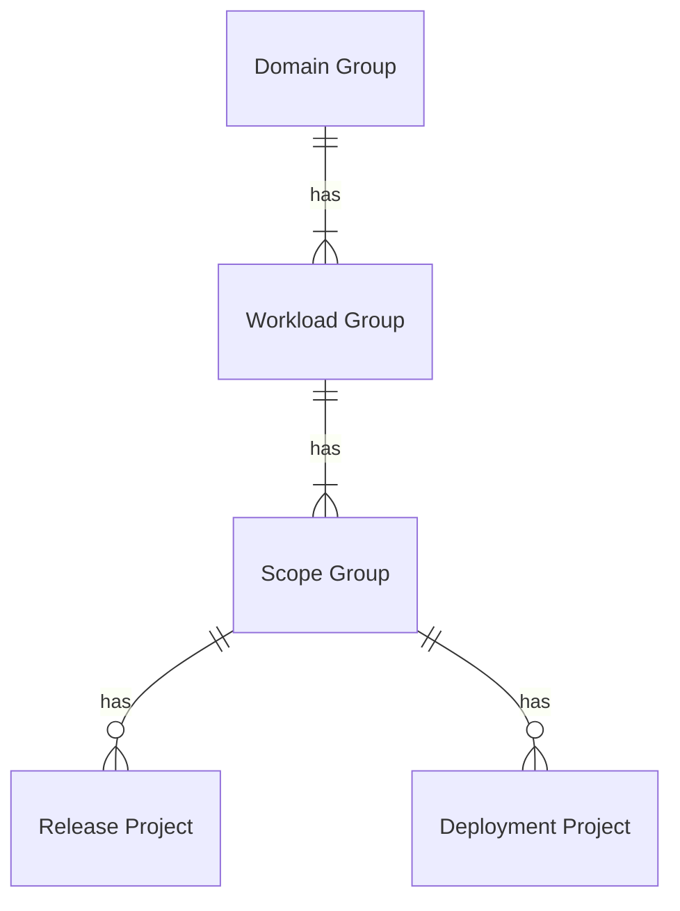

# Workload Organization - GitLab

## Overview

## Domain, Workload, and Scope Groups

Having a root level domain group is important for partitioning GitLab as a whole. It helps to organize workloads loosely by their business area (note: **not** team name).

Having workload groups under domain groups is consistent with our theme of orienting our work around workloads.

Workload groups contain scope groups. Scope groups allow for workloads support multiple trust levels. Each scope group is a security boundary that represents a trust boundary that defines a trust level.

Access for developing on a workload or one of its scopes is granted by becoming a member of the workload or scope group.

### Access to Workload and Scope Groups

We see a future where access to workload or scope groups is federated to Entra ID using the [GitLab SAML SSO](https://docs.gitlab.com/integration/saml/).

## Release and Deployment Projects

Placing release and deployment projects directly underneath the scope group commenserate with its required trust level is the simplest hierarchy we can create. It takes advantage of access controls that grant access to the workload and scope groups.

### Access to Package Projects

[We've decided to create a project with a registry and code per package](../../decision-records/gitlab-package-registry-organization.md).

This approach allows us to grant access to a group of packages, improving the flexibility and granularity of access controls, and reducing the number of necessary deploy tokens.

We also recognize that this model demands that consumers are more conscience of how they authenticate to different registries.

Access to packages stored in project package registries is controlled at the parent scope group level.

Deploy tokens created in the scope group should follow the naming conventions:

- If sharing at the domain group level: `<DESTINATION_DOMAIN_NAME>_DEPLOY_TOKEN`
- If sharing at the workload group level: `<DESTINATION_DOMAIN_NAME>_<WORKLOAD_NAME>_DEPLOY_TOKEN`
- If sharing at the scope group level: `<DESTINATION_DOMAIN_NAME>_<WORKLOAD_NAME>_<SCOPE_NAME>_DEPLOY_TOKEN`

When deploy tokens are saved as CI/CD variables in their domain, workload, or scope group, they should follow the naming convention `<SOURCE_DOMAIN_NAME_>_<WORKLOAD_NAME>_<SCOPE_NAME>_DEPLOY_{USERNAME,PASSWORD}`.

## GitLab Jira Integration

The domain group is integrated with Jira, so that commits and merge requests are efficiently linked to Jira issues.

If we ever get to the GitLab ultimate level, we can also [require Jira issues for merge requests](https://docs.gitlab.com/integration/jira/issues/#require-associated-jira-issue-for-merge-requests-to-be-merged).
